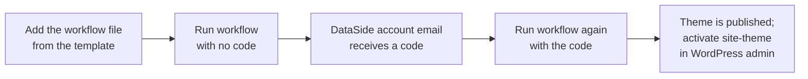
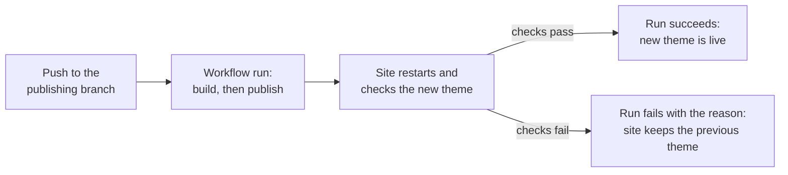

# Maintaining your DataSide WordPress theme from GitHub

You keep your WordPress theme in your own GitHub repository. A GitHub Actions workflow in that repository builds the theme and sends it to DataSide. DataSide installs it on your site and reports the result in the same workflow run. Once DataSide has turned on theme publishing for your site, no one at DataSide needs to act when you publish.

**Before you start, you need:**

- DataSide to have turned on theme publishing for each site (ask DataSide support);
- a GitHub repository that holds your theme;
- the address of each DataSide site, for example `wordpress-prod.123456789012.app.dataside.cloud`;
- access to the inbox of your DataSide account email (the address you sign in to the DataSide portal with);
- an administrator login for WordPress admin on each site.

**Time:** about 15 minutes per site. **If something fails:** contact DataSide support with the link to the failed workflow run.

## Set up once per site

1. Copy the DataSide template to `.github/workflows/dataside-theme.yml` in your repository.
2. In that file, set the site address, the branch that publishes to that site, and the directory that holds your built theme. For example, the `preprod` branch publishes to the preprod site and `main` publishes to the prod site.
3. In that file, add your build commands (for example `npm ci && npm run build`) before the DataSide publish action, `4impact/dataside-theme-action`. If your theme needs no build, add none.
4. Commit and push the file.
5. In the repository's **Actions** tab, choose **Run workflow** on the publishing branch, with the `bind-code` box empty. The run stops, and your DataSide account email receives a one-time code.
6. Choose **Run workflow** again on the same branch, and paste the code into the `bind-code` box. This run links the repository to the site and publishes your theme for the first time.
7. In WordPress admin, open **Appearance > Themes** and activate the theme named `site-theme`.

The code is valid for one use within 24 hours. If nobody in your organisation asked for a code, ignore the email.



### Sample workflow file

This sample is for a theme that builds with npm into `dist/theme`. The `preprod` branch publishes to the preprod site, and `main` publishes to the prod site. Your file has your own site addresses, branches, build commands and directory.

```yaml
name: Publish theme to DataSide

on:
  push:
    branches: [main, preprod]           # the publishing branches
  workflow_dispatch:                    # manual runs, used once per site to link it
    inputs:
      bind-code:
        description: Code from the DataSide email
        required: false

jobs:
  publish:
    runs-on: ubuntu-latest
    permissions:
      id-token: write                   # lets DataSide confirm the repository and branch
      contents: read
    steps:
      - uses: actions/checkout@v4
        with:
          persist-credentials: false

      # Your build. Leave these two steps out if your theme needs no build.
      - uses: actions/setup-node@v4
        with:
          node-version: 22
      - run: npm ci && npm run build    # writes the built theme to dist/theme

      - uses: 4impact/dataside-theme-action@v1
        with:
          site: >-
            ${{ github.ref_name == 'main'
                && 'wordpress-prod.123456789012.app.dataside.cloud'
                || 'wordpress-preprod.123456789012.app.dataside.cloud' }}
          path: dist/theme
          bind-code: ${{ inputs.bind-code }}
```

## Publish a change

Push to the publishing branch. The workflow run builds the theme, sends it to DataSide, and waits while your site restarts with it. This usually takes 2 to 5 minutes. The result of the run tells you the outcome:

- **Green tick:** your site now serves the new theme version.
- **Red cross:** DataSide rejected the new theme version, and your site keeps its previous version. The run log gives the reason, for example a PHP syntax error with the file and line. Fix the cause and push again.

GitHub emails you when a run you started fails. To roll back a change, revert the commit and push.



## What your built theme must have

- `style.css` at the top level of the built theme directory, with a `Theme Name:` header.
- PHP files that pass `php -l` (the PHP syntax check) on PHP 8.4.
- Regular files and directories only: no symbolic links.
- No need to write files inside the theme directory while the site runs. The site cannot change installed theme files; store generated files in `wp-content/uploads` instead.
- The `vendor/` directory, if the theme uses Composer packages.
- A size of at most 50 MB once packed, and 200 MB unpacked.
- For a child theme: a parent theme that DataSide provides.
- No dependency on a WordPress plugin.
